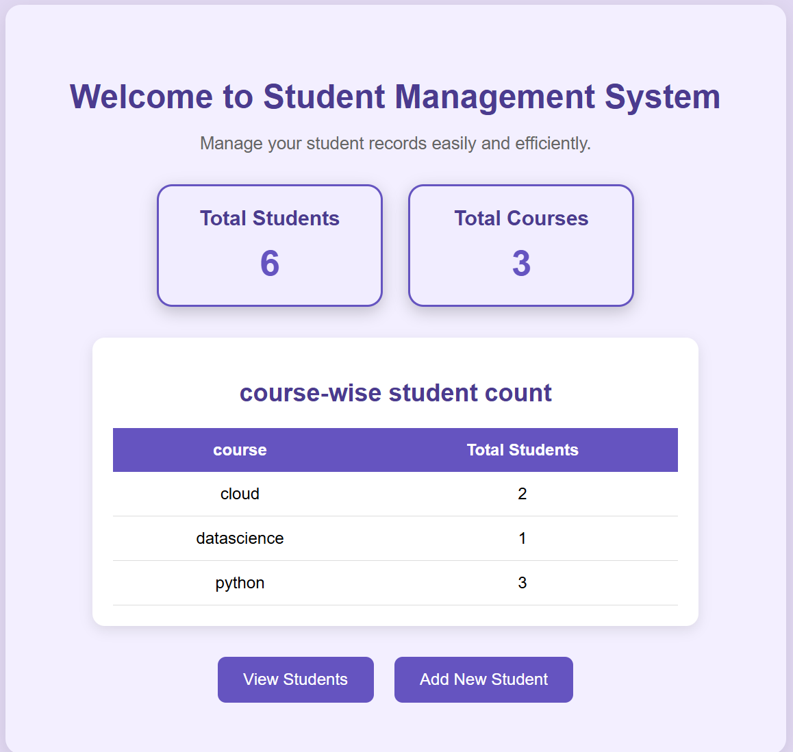
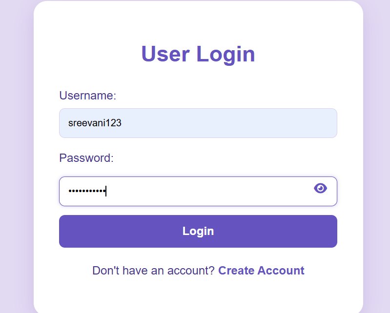
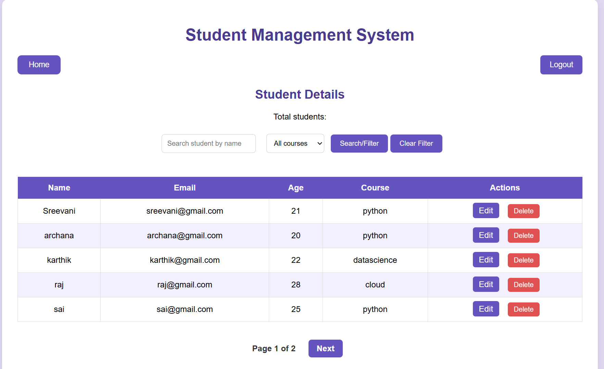
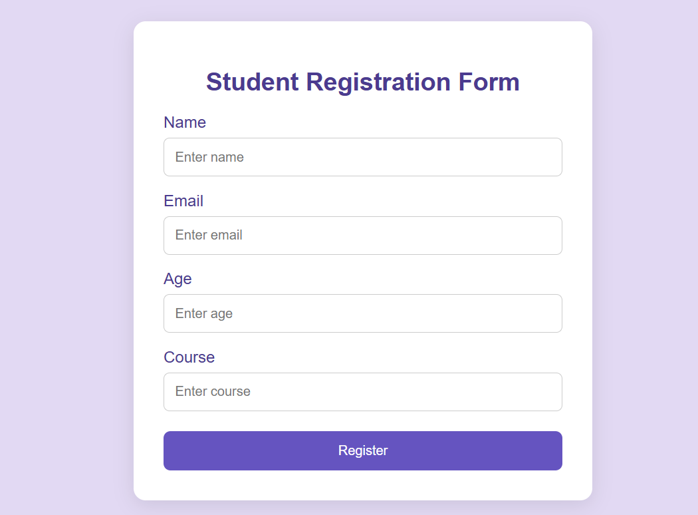

# 🎓 Student Management System

### A Django-Based Web Application for Simplified Student Record Management

\<p align="center">   A web application built with \<b>Python, Django, HTML, CSS, JavaScript, and SQLite\</b> to make student information management easier, faster, and more organized. \</p>

---

## 🌟 Project Highlights

- 👤 **User Authentication** – User registration, login, and secure logout.
- ➕ **Student Registration** – Add and store student information.
- 📋 **Manage Records** – View, update, and delete student details.
- 🔍 **Smart Search** – Find student records by name.
- 🎯 **Course Filtering** – Filter students according to their courses.
- 📊 **Dashboard** – View student and course statistics.
- 📄 **Pagination** – Display student records across multiple pages.
- ✅ **Form Validation** – Validate submitted information.
- 💬 **Success Messages** – Receive confirmation after successful operations.
- 🔐 **Password Show/Hide** – Toggle password visibility.

---

## 📖 About the Project

Managing student information manually can be difficult and time-consuming. The **Student Management System** provides a centralized web-based solution for organizing and maintaining student records.

This application allows users to register, log in, add student details, view records, update information, delete records, and search for students through a simple and user-friendly interface.

The main objective of this project is to simplify student record management and gain practical experience in Django-based web application development.

---

## 🛠️ Technology Stack

| Technology | Application           |
| :--------- | :-------------------- |
| Python     | Backend Programming   |
| Django     | Web Framework         |
| HTML5      | Page Structure        |
| CSS3       | Styling and Layout    |
| JavaScript | Frontend Interactions |
| SQLite     | Database Management   |

---

## ⚙️ How It Works

1. **User Registration / Login** – Users can create an account and log in to the application.
2. **Dashboard** – View an overview of student and course counts.
3. **Add Student** – Enter student details and save records.
4. **View Students** – Display all registered student information.
5. **Update Student** – Modify existing student details.
6. **Delete Student** – Remove student records.
7. **Search & Filter** – Find students by name or filter records by course.
8. **Pagination** – Navigate through student records page by page.
9. **Logout** – Securely log out of the application.

---

## 📸 Project Screenshots

### 🏠 Home Page


### 🔐 Login Page


### 📋 Student List


### 📝 Student Registration


---

## 🚀 Getting Started

Follow these steps to run the project on your local machine.

### 1. Clone the Repository

```bash
git clone https://github.com/sreevani-dev/student-management-system.git
```

### 2. Navigate to the Project Directory

```bash
cd student-management-system
```

### 3. Create a Virtual Environment

```bash
python -m venv venv
```

### 4. Activate the Virtual Environment

**Windows:**

```bash
venv\Scripts\activate
```

**macOS / Linux:**

```bash
source venv/bin/activate
```

### 5. Install Dependencies

If `requirements.txt` is available:

```bash
pip install -r requirements.txt
```

Otherwise, install Django:

```bash
pip install django
```

### 6. Apply Database Migrations

```bash
python manage.py migrate
```

### 7. Start the Development Server

```bash
python manage.py runserver
```

Open your browser and visit:

[**http://127.0.0.1:8000/**](http://127.0.0.1:8000/)

---

## 🗄️ Database

**SQLite**

SQLite is used to store and manage student information.

---

## 🎯 Learning Outcomes

Through this project, I gained practical experience in:

- Python-based web application development.
- Django framework and project structure.
- Database integration using SQLite.
- CRUD operations and database management.
- User authentication and form handling.
- Django views, models, and templates.
- Frontend development using HTML, CSS, and JavaScript.

---

## 🔮 Future Improvements

- 📸 Student profile photo uploads.
- 📅 Attendance management.
- 📝 Marks and academic performance tracking.
- 📁 Export student records to Excel and PDF.
- 🔐 Role-based access for administrators and staff.

---

## 📌 Project Status

**Completed** – Core features and functional testing completed.

---

## 👩‍💻 Author

**Sreevani Pandilla**

GitHub: [@sreevani-dev](https://github.com/sreevani-dev)

---

## 🔗 Project Repository

[View Student Management System on GitHub](https://github.com/sreevani-dev/student-management-system)

---

\<p align="center">
&#x20; \<b>Built with Python & Django ❤️\</b>
&#x20; \<br>
&#x20; \<i>Learning, Building, and Growing!\</i>
\</p>

## screenshots





